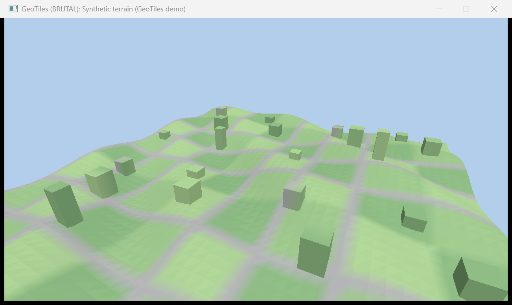
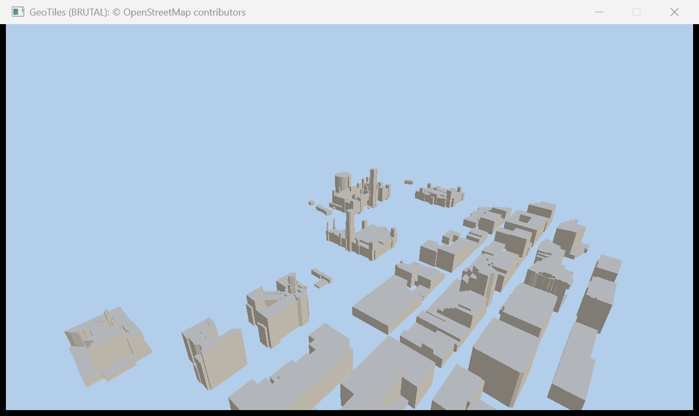

# GeoTiles: OGC 3D Tiles in a BRUTAL window

A demo on top of the [BRUTAL evaluation](../README.md): it loads the 3D tiles around a place and draws them with
Vulkan through BRUTAL's bindings, in the renderer of `HallSlice` (M2). The tiles are either Google's
[Photorealistic 3D Tiles](https://developers.google.com/maps/documentation/tile/3d-tiles) (Map Tiles API), or a
synthetic tileset when there is no API key. With `--osm` it draws the buildings of OpenStreetMap instead: open
data, no key.



## Run

```powershell
# No key, no network: a made-up square kilometre, through the same path as Google's tiles.
dotnet run --project Experiments/Brutal/GeoTiles/GeoTiles -- --synthetic

# Google's tiles around a place (default: Parliament Hill, Ottawa). The key stays in the environment.
$env:GOOGLE_MAPS_API_KEY = '<your key>'
dotnet run --project Experiments/Brutal/GeoTiles/GeoTiles -- --lat 45.4236 --lon -75.7009 --height 40 --radius 400

# OpenStreetMap buildings around the same place, extruded: one request to the public Overpass server, no key.
dotnet run --project Experiments/Brutal/GeoTiles/GeoTiles -- --osm

dotnet test Experiments/Brutal/GeoTiles/GeoTiles.Tests
```

| Option | Default | Meaning |
|---|---|---|
| `--lat`, `--lon` | 45.4236, -75.7009 | the place looked at, in degrees |
| `--height` | 40 | its height above the WGS84 ellipsoid, in metres (not above sea level) |
| `--radius` | 400 | only tiles within this many metres of the place are fetched |
| `--sse` | 16 | tolerated screen-space error, in pixels; lower fetches finer tiles |
| `--max-tiles` | 120 | a cap on the meshes fetched, so a mistake costs a bounded number of requests |
| `--seconds` | 20 | the window closes by itself after this long |
| `--synthetic` | | use the synthetic tileset even when a key is set |
| `--osm` | | OpenStreetMap buildings (Overpass) instead of tiles; wins over the key |
| `--no-window` | | load, print the counts and exit |
| `--fullscreen` | | the primary monitor at its current mode, instead of a 1280 x 720 window |

In the window: the camera orbits; the arrow keys turn and tilt it, W and S move it in and out, Esc closes.

## How it works

| Step | Where | What |
|---|---|---|
| Fetch | `TileSource.cs` | `root.json` with the key; every later request carries the key and the `session` that the tilesets name in their URIs. The key is sent to `tile.googleapis.com` over HTTPS only, and never appears in an error message. |
| Tree | `Tileset.cs` | `tileset.json`: bounding volumes (box, sphere, region) reduced to spheres, geometric error, `REPLACE` or `ADD`, transforms, nested tilesets. |
| Select | `Selection.cs` | The screen-space error of each tile from the eye decides whether its children replace it. Tiles away from the place are skipped. |
| Decode | `Glb.cs` | GLB, the node hierarchy, `KHR_draco_mesh_compression` through `Openize.Drako`, the base colour image as bytes. glTF's y-up is turned to the tileset's z-up. |
| Locate | `Geo.cs`, `Scene.cs` | Positions stay in ECEF **doubles** until they are expressed in an east-north-up frame at the place; only then do they become floats. In ECEF a float steps by half a metre; in the local frame it keeps millimetres (a test holds both). |
| Draw | `GeoTiles/Program.cs` | `HallSlice`'s renderer and one vertex buffer. A tile is drawn with its own image (sRGB, full mip chain, trilinear) and no lighting: a photograph carries its own. What has no image is drawn by colour with flat shading. |
| OpenStreetMap | `OsmBuildings.cs` | Footprints of an Overpass answer, extruded to `height`, `building:levels` or 8 m; concave roofs by ear clipping. |

`GeoTiles.Core` has no BRUTAL reference, so all of this but the last row is tested without a GPU.

## What is verified, and what is not

- **Verified, 2026-11-11, Windows:** 20 tests, among them the whole path on the synthetic tileset (nested tileset,
  Draco, PNG texture, ECEF to local) and the extrusion of an L-shaped footprint. Four mutants of the core each fail
  a test: no y-up to z-up, no ECEF to local, always refine, session dropped.
- **Google's tiles, same day, with a key:** Parliament Hill in Ottawa loads and draws. 30 tiles at the cap:
  124,711 triangles in 41 requests; 200 tiles at `--sse 8`: 140 images, 86 MB with their mips, 59 fps with vsync at
  1280 x 720. The session, the nested tilesets, Draco and the JPEG textures worked as documented.
- **OpenStreetMap, same day:** 488 footprints around the same place, 11,087 triangles, one request, 60 fps. The
  public Overpass server took more than 40 s to answer one time in three.
- **Full screen:** 3840 x 2160 at 61 fps on the synthetic tileset.



*Buildings © OpenStreetMap contributors.*

## Limits of this slice

- **One selection, at start.** The tiles are chosen once for the first camera position; moving the camera does not
  fetch finer tiles. There is no frustum culling and no streaming, and coarse tiles stay at the edge of the place.
- **JPEG and PNG only.** KTX2 and WebP images do not decode; such a tile is drawn grey.
- **Attribution is in the title bar and on the console**, not in the picture, and Google's logo is not shown.
- **OpenStreetMap:** flat roofs, one colour, no ground; rings of a relation that are split over several ways are
  skipped and counted.

## Google's terms

These tiles are not open data. This demo is built for them as follows, and anything beyond private prototyping
needs more:

- **No tile is written to disk** or committed: they live in memory for one run. A disk cache was tried on
  2026-11-11 and removed: the tiles allow four hours (`max-age=14400, private`), but their names change with
  every session and the root request that opens a session may not be reused (`max-age=0`), so nothing is ever
  read back from one run to the next. Do not commit captures of Google's imagery to this repository; the captures
  here are of the synthetic tileset and of OpenStreetMap.
- **Attribution must be visible with the imagery.** The tiles name their data providers (`asset.copyright`); the
  demo collects them and shows them with "Google" in the title bar. Showing them inside the viewport with Google's
  logo is required before any picture or build of this leaves the machine, and is not done yet.
- Requests are billed past the free quota: a run makes one root request and a few dozen to a few hundred tile
  requests, bounded by `--max-tiles`.

For data that can be stored and redistributed, use open sources instead: `--osm` draws OpenStreetMap's buildings
(ODbL, with the attribution above); SRTM or municipal LiDAR elevation would give them a ground.
