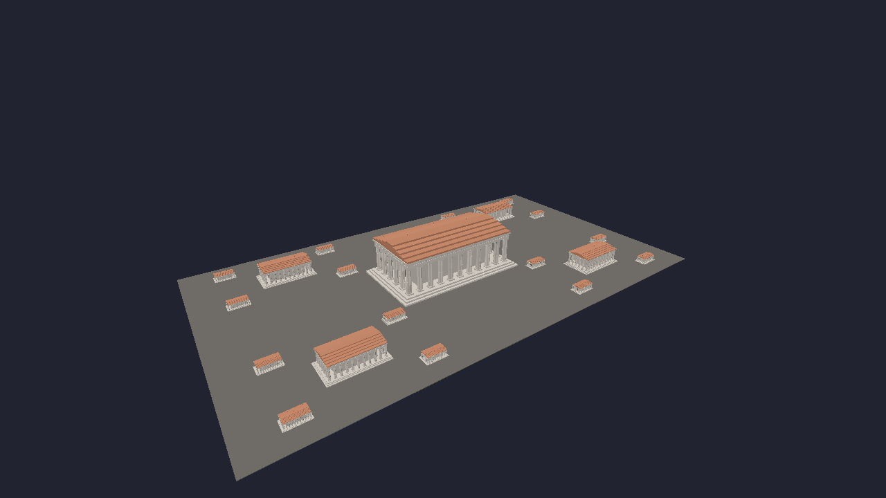
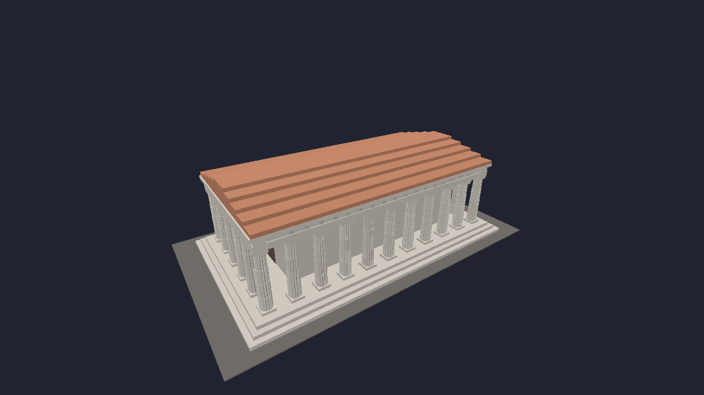
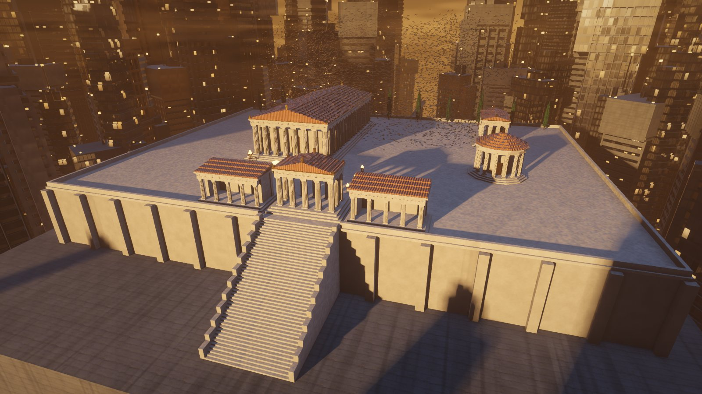
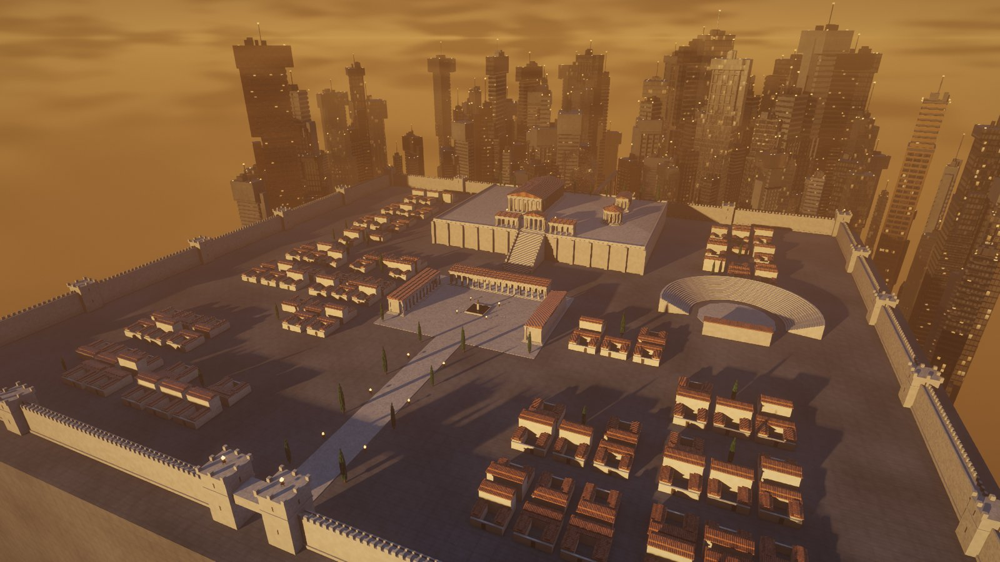
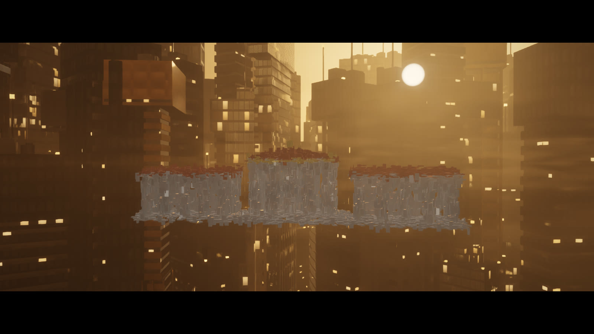
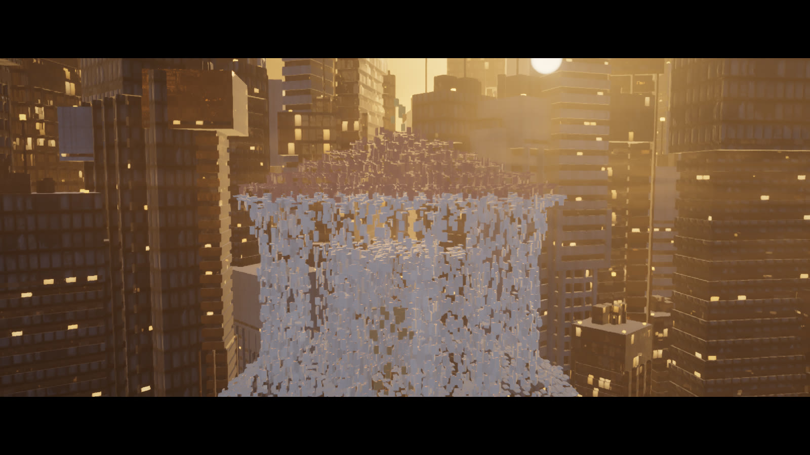
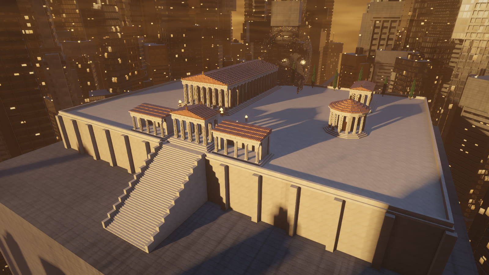
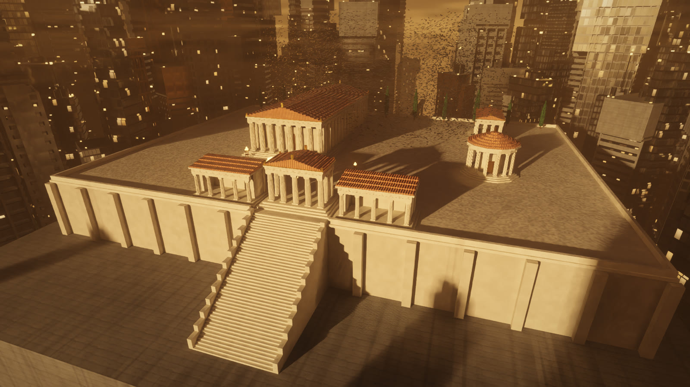

# BRUTAL evaluation

A small, isolated prototype to judge whether [BRUTAL](https://github.com/ahwootech/BRUTAL), Ahwoo's C# framework with
native bindings (GLFW, Vulkan, ImGui, Jolt…), is useful for the Observatory and for composable software-factory
experiments. It is an evaluation, not a plan to replace Godot or the NVIDIA RTX fork. Coordination:
[GuitarAlchemist/gaia#257](https://github.com/GuitarAlchemist/gaia/issues/257).

## Pinned

- **Upstream:** `ahwootech/BRUTAL` `main` @ `a25cdf80b2a15530e7da6cff744def9d841ad3c3`.
- **Packages:** NuGet only, because upstream has no project files or build scripts yet. Exact versions are in the
  project files; transitive versions are in each project's `packages.lock.json`, written by the first restore.
  - `Ahwoo.Brutal.Core` 2026.10.1
  - `Ahwoo.Brutal.Glfw` 2026.10.4
  - `Ahwoo.Brutal.Vulkan` 2026.10.2, `Ahwoo.Brutal.Vulkan.Abstractions` 2026.10.2 and `Ahwoo.Brutal.ShaderC` 2026.10.2
    (M2 only)
- **SDK:** .NET 10, through the repository's `global.json`. Run `dotnet` from inside the repository, because the
  current directory decides which SDK runs.

## Licence obligations

The [BRUTAL License v1.0](https://github.com/ahwootech/BRUTAL/blob/main/LICENSE.txt) is MIT-based with attribution
terms. Any build distributed to anyone must:

- credit Ahwoo in its credits screen (2.1);
- show the unaltered BRUTAL logo before its primary function starts (2.2);
- ship upstream's `NOTICE.txt` alongside (2.3).

Each library also carries third-party notices in its `LICENSES` folder. This prototype is not distributed. FMOD is
proprietary and separately licensed, so `Brutal.Fmod` is not used.

## Milestones

| Milestone | Status | Evidence |
|---|---|---|
| M0: discover and scope | PASS | [ACK and M0 report](https://github.com/GuitarAlchemist/gaia/issues/257#issuecomment-6282507425) |
| M1: one window, input, clean close | PASS, 7/7 checks, 2026-10-19 | [evidence/m1-20261019-233551.md](evidence/m1-20261019-233551.md) |
| M2: a small Observatory-relevant visual slice | PASS, 11/11 checks with vsync, 2026-10-19; uncapped, it starves the RTX view | [evidence/m2-20261019-235332.md](evidence/m2-20261019-235332.md) (vsync), [evidence/m2-20261019-235218.md](evidence/m2-20261019-235218.md) (uncapped) |
| M3: measurements | INCONCLUSIVE, 2026-10-20: up to a 1,000 fps cap the view holds; uncapped, the collapse did not come back, and the view varies on its own | [evidence/m3-20261020-000131.md](evidence/m3-20261020-000131.md) (sweep), [evidence/m3-20261020-000727.md](evidence/m3-20261020-000727.md) (controls) |
| M4: report and continue/park recommendation | DONE, 2026-10-20: park for the Observatory; re-enter only for a small C# tool on GA's code | [M4](#m4-report-and-recommendation) |

## M1

`HelloBrutal` is upstream's first-window sample, with these changes:

- the window is 640×360;
- it logs key presses;
- it closes on Esc, or after 10 s;
- it prints its loop and key counts.

It uses no graphics API, so a blank window proves the lifecycle only.

```powershell
pwsh -File Experiments/Brutal/run-m1.ps1   # refuses to build when commit > 125 GB or free RAM < 8 GB
```

The script checks memory headroom, then builds once and runs once. During the run it waits for the window, sends `b`,
takes a screenshot and sends Esc. It records each check as PASS, FAIL or NOT RUN:

- the build;
- the restored packages, and their native binaries with hash and signer;
- the window opening;
- the key input;
- the clean exit;
- leftover processes;
- whether the Godot processes running beside it were left alone.

### M1 result (2026-10-19)

- **Run:** all seven checks passed. The window opened 167 ms after start, `b` and Esc arrived through `OnKey`, the app
  exited with code 0 and left no process. Peak working set was 36 MB.
- **Host:** the run budget was lowered, with the operator's agreement, to 6 GB of commit headroom and 4 GB free. The
  host stayed at 139–140 of 148.6 GB committed throughout.
- **Pause keys:** the log also shows Pause presses that nobody typed. They are a known quirk of this host (the focused
  window receives Pause about 5 times a second), not a BRUTAL event.
- **Loop rate:** about 58 iterations per second, set by `Thread.Sleep(1)` and Windows' 15.6 ms timer. It is not a frame
  rate: nothing is drawn.
- **Native binaries:** the Windows `glfw3.dll` in `Ahwoo.Brutal.Glfw` 2026.10.4 is unsigned. Its SHA-256 is in the
  evidence.
- **Preview dependency:** the restore pulls `Microsoft.Extensions.ObjectPool` 11.0.0-preview transitively.
- **Earlier runs:** an earlier run passed every check, but its screen copy caught the desktop around the window; it was
  discarded and the script now captures the window alone (`PrintWindow`). A run in between failed the key checks
  because the script started the app without a console (`-NoNewWindow`), which broke focus. That was a harness bug,
  reverted, not a BRUTAL result.

## M2

`HallSlice` draws a slice of the Observatory's hall with Vulkan, through BRUTAL's bindings: the floor, the ring of 16
piers with their lintels, and the central pedestal with the statue, as 35 flat-shaded boxes (1,260 vertices) with a
depth buffer, at 1280×720. Its two GLSL shaders are compiled at start-up with `Ahwoo.Brutal.ShaderC`. The camera
orbits the axis by itself; the arrows turn and tilt it, W and S move it in and out. Upstream has no rendering sample, so
the instance, swapchain, render pass, pipeline and frame loop (two frames in flight) are written here, after the Vulkan
renderer in upstream's `Brutal.ImGui.Backends`. The window has a fixed size: a swapchain that goes out of date ends the
run instead of being rebuilt.

```powershell
pwsh -File Experiments/Brutal/run-m2.ps1 -Vsync -FpsLog <log of a Godot view printing FPSLOG lines>
```

The script gates on memory like M1, builds once and runs once. It waits for the window, sends Left, Up and W, captures
the window, samples the GPU each second and sends Esc after 12 s. To M1's checks it adds:

- the first frame;
- a picture that is not blank;
- the three camera keys;
- the frame times;
- given the log of a Godot view that prints `FPSLOG <local time> <fps>` each second, that view's frame rate while
  HallSlice ran.

For the runs below, the RTX view printed those lines through a temporary piece in its `live/add/` folder, removed
afterwards.

### M2 result (2026-10-19)

| | Uncapped (immediate present) | Vsync (FIFO) |
|---|---|---|
| Evidence | [m2-20261019-235218](evidence/m2-20261019-235218.md) | [m2-20261019-235332](evidence/m2-20261019-235332.md) |
| Checks | 9/11 (see below) | 11/11 |
| HallSlice frame rate | 10,059 fps | 60 fps |
| Frame time p50 / p95 / p99 / max | 0.073 / 0.187 / 0.334 / 5.0 ms | 16.64 / 16.81 / 17.01 / 46.8 ms |
| Shader compilation, first frame | 208 ms, 648 ms | 141 ms, 849 ms |
| CPU (24 logical CPUs) | 3.4 % | 0.2 % |
| Peak working set | 143 MB | 208 MB |
| Video memory, whole card | +93 MiB | +105 MiB |
| **RTX view beside it** | **fell from 60 to 2–3 fps for the whole run**, back to 60 within a second of Esc | **stayed at 60 fps** |

- **Uncapped rendering starves the RTX view.** Presenting as fast as it could, HallSlice took the Godot RTX view from
  60 fps to 2–3 fps for the 13 s it ran. With vsync, the same scene left the view at 60 fps. HallSlice had the focus
  in both runs, so the drop comes from sharing the GPU, not from the view losing focus. Any BRUTAL tool that runs
  beside the RTX view must cap its frame rate.
- **GPU load:** the whole card stayed near 30 % busy in both runs, and its power fell from 98 W to 80 W in the uncapped
  run. The card did less work, not more, which points at scheduling between the two processes rather than throughput.
  That reading is an inference, *to verify* in M3.
- **More unsigned native binaries:** `shaderc_shared.dll` and `SPIRV-Tools-shared.dll` (ShaderC 2026.10.2) and
  `VulkanEx.dll` (Vulkan 2026.10.2) are unsigned, like `glfw3.dll`. Their hashes are in the evidence.
- **The binding is thin.** The Vulkan structs, enums and calls come through nearly one to one, with C# names
  (`VkFormat.B8G8R8A8SRGB`), `ByteSize` for sizes and spans for arrays. Nothing helps with the swapchain or the
  pipeline: `Program.cs` is about 650 lines, half of it Vulkan set-up and tear-down.
- **Uncapped run, camera keys:** this check failed because of the harness, not BRUTAL. `SendKeys` sends `{LEFT}`
  without the extended-key flag, and GLFW reads it as the keypad's 4. The script now sends the arrows with their
  extended scan codes, and HallSlice logs the keys it has no action for. The vsync run passed with that fix. The
  uncapped run also predates that logging, so its binary differs from the committed one by those lines.
- **Not done from the proposal:** no recording, as the screenshots and logs carry the evidence; and keys instead of a
  mouse drag and wheel for the camera.

## M3

`HallSlice` now takes `--cap N`: it paces frames to N a second with 1 ms sleeps and a short spin. It also records frame
times from one present to the next; M2 measured from the start of a frame's work to its present. `run-m3.ps1` gates on
memory and builds once. It then runs HallSlice for 15 s per setting, 6 s apart: a vsync soak first, then each cap. For
each run it reads the RTX view's frame rate from its `FPSLOG` lines, both during the run and in the pause before. A cap
of -1 runs a control: the same window, with no HallSlice.

```powershell
pwsh -Command "& ./Experiments/Brutal/run-m3.ps1 -FpsLog <log> -Caps @(60,120,240,480,1000,0)"   # -File would pass -Caps as one string
```

### M3 result (2026-10-20): inconclusive

- **Question:** at which frame cap does HallSlice leave the RTX view at 60 fps?
- **Hypothesis, written before measuring:** the view holds with HallSlice capped at 240 fps, and collapses somewhere
  between 1,000 fps and uncapped.

Sweep, [m3-20261020-000131](evidence/m3-20261020-000131.md):

| HallSlice | Its fps | Frame ms p50 / p99 / max | View fps min / median | Whole card: GPU %, W |
|---|---|---|---|---|
| vsync, 60 s | 60 | 16.67 / 17.56 / 66.5 | 56 / 60 | 29, 100 |
| cap 60 | 60 | 16.66 / 17.23 / 19.1 | 60 / 60 | 28, 102 |
| cap 120 | 120 | 8.33 / 8.93 / 9.7 | 59 / 60 | 29, 102 |
| cap 240 | 240 | 4.17 / 4.71 / 5.2 | 60 / 60 | 30, 103 |
| cap 480 | 469 | 2.08 / 5.55 / 30.6 | 59 / 60 | 29, 104 |
| cap 1000 | 980 | 1.00 / 2.94 / 9.4 | 60 / 60 | 30, 107 |
| uncapped | 10,803 | 0.064 / 0.63 / 11.5 | 51 / 59 | 48, 115 |

Controls alternated with uncapped runs, [m3-20261020-000727](evidence/m3-20261020-000727.md):

| Start | Run | View fps min / median | Whole card: GPU %, W |
|---|---|---|---|
| 00:07:52 | control | 57 / 60 | 25, 96 |
| 00:08:13 | uncapped, 12,480 fps | 60 / 60 | 51, 117 |
| 00:08:36 | control | 60 / 60 | 28, 91 |
| 00:08:57 | uncapped, 12,052 fps | 60 / 60 | 50, 117 |
| 00:09:19 | control | 49 / 57 | 27, 89 |
| 00:09:40 | uncapped, 10,308 fps | 38 / 51 | 50, 110 |

- **Capped:** at every cap up to 1,000 fps, the view kept a median of 60 fps.
  - Its minimum of 59 at caps 120 and 480 is its counter alternating between 59 and 61. It does that with nothing
    beside it too.
  - The sweep's evidence marks those rows "drops" because that run's threshold was exactly 60. The script now allows
    2 fps (`-Tolerance`).
- **Uncapped:** across four runs, the view's minimum was 60, 60, 51 and 38. M2's fall to 2–3 fps did not come back.
- **The view varies on its own:** two of the three controls dipped too, to 57 and to 49, with nothing running beside it.
  Its scene moves (flyovers, timed events), so its load changes from one 15 s window to the next.
- **Verdict:** inconclusive.
  - The capped half agrees with the hypothesis.
  - The collapse is neither confirmed nor ruled out. M2's single observation stands, and the controls are too noisy to
    show a smaller effect.
- **Recommendation:** a BRUTAL tool next to the RTX view should still be capped. Uncapped, HallSlice took the card from
  about 27 % to 50 % busy and from about 90 W to 115 W, and nothing it draws needs more than a capped rate.
- **To settle it:** a quiet view (fixed camera, timed events off) and more alternated pairs. That changes the live
  view's state, so it is the operator's call.
- **Afterwards:** the RTX view was still running at the end of the runs. Its log ends at 00:21:53, and the machine was
  restarted afterwards (booted at 2026-10-20 00:23).

## M4: report and recommendation

**Recommendation: park BRUTAL for the Observatory.** Re-enter only for one narrow case, under conditions. The decision
is the epic owner's.

### What M0–M3 showed

| Area | Finding |
|---|---|
| Fit | Godot already gives the Observatory its scene, path tracing with DLSS, and the web build. BRUTAL is a set of bindings: everything above the API (scene, materials, lighting, export) would be ours to write. |
| Effort | Upstream has no project files, build scripts or rendering sample. A first lit scene with a depth buffer took about 650 lines, half of them Vulkan set-up and tear-down (M2). |
| Performance | Fast and small. The window opened in 167 ms (M1). The first frame came in 0.53–0.85 s, with shaders compiled in 141–208 ms. Peak working set was 141–208 MB, and CPU 0.2 % under vsync (M2, M3). |
| Coexistence | Beside the RTX view it must be capped. One uncapped run took the view from 60 to 2–3 fps (M2). Four more did not repeat that, but they doubled the card's load (M3). |
| Supply chain | Four native binaries are unsigned: `glfw3.dll`, `shaderc_shared.dll`, `SPIRV-Tools-shared.dll` and `VulkanEx.dll`. A .NET 10 project pulls `Microsoft.Extensions.ObjectPool` 11.0.0-preview transitively. At M0, each package had a single published version. |
| Licence | MIT-based, with attribution. Any distributed build must credit Ahwoo, show the unaltered BRUTAL logo before its primary function, and ship `NOTICE.txt`. |
| Web | Not evaluated. The packages used here target desktop windows (GLFW) and Vulkan, and none of them gives the Observatory a web build. |

### Why park

- **It adds work:** it replaces nothing Godot does for the Observatory, and it would add a renderer to write and
  maintain.
- **Supply chain:** the unsigned native binaries and the preview dependency would need work before anything built on it
  ships.
- **Licence:** the logo-before-start requirement applies to every distributed build, small tools included.

### When to re-enter

One case could suit it: a small native C# tool built around GA's own .NET code, where a full engine is more than the
tool needs. A fretboard or voicing visualiser, or a debug panel with upstream's ImGui bindings, are examples. Before
starting:

- build the native binaries from upstream's source, or verify them against published hashes;
- accept the licence's credit, logo and `NOTICE.txt` for anything distributed;
- pin exact versions and keep the lock files, as here;
- apply a frame cap and the memory gate whenever it runs next to the RTX view.

### Left open

- **The collapse:** whether uncapped rendering really collapses the RTX view rests on one observation (M2), which M3
  did not reproduce. Settling it needs a quiet view and more alternated pairs.
- **Upstream:** the unsigned binaries could be reported there. This evaluation does not touch other repositories.
- **This PR:** it is a draft. Merge it as a record, or close it if the prototype should not live in GA.

## Showcase: Colossus (2026-10-20)

Asked after M4: « Je veux voir ce que brutal a dans le ventre ». `Colossus/` uses more of BRUTAL at once: Vulkan, Jolt,
Dear ImGui, ImPlot, glTF and OpenAL. It is an original scene with no outside assets. A lone figure stands at the end of a walkway in a
city of towers. Above it, 6,000 machines circle, each one a Jolt rigid body. They gather into a colossal face, built
from Gaussian bumps, which looks at the figure and speaks, then disperses again.

Run it with `dotnet run -c Release` in `Colossus/`. It takes `--swarm N` (default 10,000), `--seconds T`, `--immediate`
(no vsync), `--mailbox` (no vsync and no tearing), `--images N` (swapchain images, default 2), `--hidden` (an invisible window,
for measuring) and `--capture T1,T2,...`, which saves the window's image at those seconds as `colossus-<T>s.png` in the working directory.
The sound takes `--mute`, `--no-sound`, `--no-voice` and `--face-file PATH` (below); `--lang fr|en` sets the panel's language.
The capture copies the swapchain image to a host buffer, so it also works where a desktop screenshot cannot (a locked
session, or a window with no vsync).

**Keys:**
- Space: assemble or disperse;
- C: change the camera;
- drag: turn the camera;
- wheel: zoom;
- Esc: quit.

**Rendering.** The scene is about 2,000 lines in one file. The towers are 12 variants modelled in Blender (below) and
read with BRUTAL's glTF loader (`Ahwoo.Brutal.Gltf`). Everything else is an instance of one cube mesh. That makes 10,407
instances in 13 draw calls: one for each tower variant, and one for every cube.
- The scene pass renders in HDR, with 4x MSAA and reversed infinite depth.
- Towers get procedural windows, which fade to their average where a cell gets smaller than two pixels.
- Machines get seams and a pulsing eye.
- Machines and towers are box-mapped with two texture sets (below): albedo, a tangent-space normal, and roughness.
- A second pass adds:
  - the sky, with a low sun and bands of smog;
  - a bloom built by blitting the HDR image's mips;
  - ACES tone mapping, split toning, a vignette and grain.
- The panel then draws over it.

**Measured** on the RTX 5080, at 1600×900:

| Run | Frame time | Jolt step (6,000 bodies, 6 threads) | Other |
|---|---|---|---|
| vsync, 20 s | p50 16.69 ms, p95 18.36, p99 19.86 | p50 3.24 ms, p99 4.21 | — |
| uncapped | about 270 fps | — | GPU about 10 % busy |
| any run | — | — | peak working set 224 MB |
| textured, vsync, 22 s | 1,261 frames, p50 16.66 ms, p95 16.98, p99 17.69 | p50 3.52 ms, p99 4.09 | 60.0 fps |
| textured, uncapped, 22 s | p50 4.09 ms, p95 6.28, p99 10.00 | p50 2.76 ms, p99 7.68 | about 240 fps |
| head, 10,000 bodies, vsync, 22 s, 2 images | 1,258 frames, p50 16.65 ms, p95 18.22, p99 20.77 | p50 6.12 ms, p99 8.01 | worst second 60 frames |
| the same, 3 images, two runs | 1,257 and 1,266 frames, p50 about 12.5 ms, p95 about 28.8 | p50 about 6.0 ms | worst second 60 frames |

With three images the frames still come at 60 a second, but the loop's own timings alternate short and long; two
images keep them even, so two stay the default.

Two traps in measuring this:
- **A locked session throttles vsync.** While Windows shows its lock screen, a vsync'd window gets about 4 frames a second
  (about 264 ms each, the GPU idle). This happened with every build, the oldest included. Uncapped runs are not affected.
- **The desktop in use stalls the loop.** In two of four vsync runs taken while the desktop was in use, one frame took
  about 1 s. A temporary timer put all of it in `Glfw.PollEvents`, that is in Windows' window messages, not in the
  rendering. The summary now gives the worst full second's frame count, which shows such a stall at once.

**Textures** (`Colossus/textures/`, 512² PNGs). Two seamless albedos were generated locally with ComfyUI:
- **Model:** Z-Image-Turbo (`Tongyi-MAI/Z-Image-Turbo`, Apache-2.0), in Comfy-Org's repackage (Apache-2.0), with the
  Qwen3-4B text encoder (Apache-2.0). These were already on the machine; nothing was downloaded.
- **Workflow:** 8 steps, then the image offset by half and the seam cross repainted.
- **Prompts and seeds:** they are in `generate_comfyui.py`; hull is seed 1207, facade seed 2026.
- **Concrete and cladding** (2026-10-20, asked as « plus de verre, métal, béton », « utilise ComfyUI et Blender pour
  les textures »): two more, the same way and with the same model, seeds 1965 and 1972. One is board-formed concrete
  with tie holes, the other brushed metal panels.

Blender 5.2 then baked each albedo, headless with factory settings (`bake_blender.py`):
- a tangent-space normal map, from a Bump node on its luminance;
- a roughness map, from the same luminance.

It packs normal X, normal Y, roughness and height into one RGBA map. The scene loads the PNGs (twelve since the marble and terracotta of 2026-10-21) into one texture
array with mips; its own PNG reader is in `Program.cs`.

**Materials and RTX** (2026-10-20, asked as « une scène plus jolie (plus de verre, métal, béton) », « plus de features
NVIDIA »). One shader function gives every surface, and the reflections call it again where their rays land.
- **Tower styles.** Each modelled tower takes a style from its seed:
  - mirror glass walls;
  - bronze or steel cladding;
  - raw concrete;
  - the facade texture's panels.

  The mesh's own glass, metal and lamps stay as modelled.
- **Curtain walls.** Glass comes in cells of 1.6 m by one floor, with mullions and a spandrel at each slab. A few offices
  are lit from their ceilings, and some panes have their blinds down. Each pane leans a little, so that reflections break
  from pane to pane.
- **Lighting.** GGX highlights and Schlick's Fresnel. A cooler sky and fill light set the shade against the warm sun.
- **Ray queries.**
  - The sun's shadows take two rays through its disc, so their edges soften.
  - Ambient occlusion takes four rays of up to 6 m.
  - A mirror ray on glass and metal lands on a surface that is shaded in full: its material, read from the mesh and
    instance buffers, the sun on it and its own shadow ray.
  - The rays' noise is fixed on the screen, so a still view does not shimmer.
- **Cost.** The scene pass went from 0.85 to about 3 ms of GPU a frame (p95 6 ms), well within 60 frames a second.
- **Not done.** DLSS, frame generation and Reflex: they need NVIDIA's Streamline in the Vulkan renderer, with motion
  vectors and jitter.

**The head** (`Colossus/head/`). The swarm now forms a sculpted head, generated locally rather than built from Gaussian
bumps. The bumps remain the fallback when the file is missing.

It is made in two steps (2026-10-20). First, `generate_comfyui.py` runs ComfyUI:
- **Portrait:** Z-Image-Turbo paints a frontal portrait of an imaginary marble bust, seed 7311, prompt in the script.
  The bust is androgynous and ageless, and the prompt names no one.
- **Cut-out:** BiRefNet (MIT) removes the background.
- **Mesh:** TRELLIS.2 (`microsoft/TRELLIS.2-4B`, MIT; int8 build) turns the portrait into a mesh. It runs in ComfyUI's
  native nodes, with DINOv3 ViT-L features (DINOv3 License). The graph is learn's ga-lab `ga-3d-trellis2` workflow,
  shape stage only. Built with DINOv3.

The models were already on the machine; nothing was downloaded. The run took 141 s.

Then `bake_blender.py` (Blender 5.2, headless) turns the mesh into the swarm's targets:
- **Cleanup:** it smooths the mesh. It keeps the largest connected piece, and only the outer skin: a triangle whose
  normal ray meets the mesh again is dropped. TRELLIS.2 left internal walls, and 26,202 of 135,729 triangles remain.
- **Selection:** it keeps what faces the figure, down to the upper neck.
- **Sampling:** it samples 20,000 points as blue noise in progressive order, so that the first n of them cover the
  head evenly for any swarm size.
- **Weights:** each point gets a normal and three weights:
  - eyes and mouth, which glow;
  - jaw, which drops with each syllable.

**The city** (`Colossus/city/`). `build_towers.py` models 12 tower variants in Blender 5.2, headless, from seeds. They
are original brutalist massing, made from boxes and cylinders by rule:
- **Masses:** a shaft in two to four stacked masses, each set back from the one below or cantilevered over it.
- **Facades:** each mass gets one of three: ribbon windows set 0.45 m behind concrete spandrels; an egg-crate grid of
  piers and deep spandrels; or vertical fins.
- **Extras:** a windowless service core, plant floors with louvres, a cantilevered crown, roof plant, vents, a mast,
  and amber warning lamps.

They are exported as one GLB (`towers.glb`, 12 meshes, about 1 MB). The materials are named concrete, glass, metal and
lamp, and the scene shades each by its name:
- **Concrete:** the facade texture.
- **Glass:** lit cells, one floor high and 1.6 m wide.
- **Metal:** the hull texture.
- **Lamps:** they glow.

The 420 towers of the ring are those variants, each turned and scaled. The boxes remain the fallback when the file is
missing. With the city and 10,000 machines, vsync over 22 s gave 1,254 frames, worst second 60, and the GPU about 17 %
busy.

**RTX** (asked as « max out comme l'observatoire »). When the GPU has ray queries, the scene traces against the whole
scene, unless `--no-rtx` is given. `--rtx-off` starts with it unticked, and the panel toggles it.
- **Device:** `VK_KHR_acceleration_structure` and `VK_KHR_ray_query`, with buffer device addresses, all through BRUTAL's
  bindings.
- **Bottom level:** one structure for the cube and one for each tower variant, built once from the vertex buffer.
- **Top level:** one per frame in flight over all 10,407 instances, rebuilt each frame as the swarm moves.
- **Shader:** one ray toward the sun for the shadow. On glass and metal, one more ray along the mirror direction: what it
  meets replaces the sky in the reflection, as a dark facade or a lamp, hazed by its distance.
- **Masks:**
  - the swarm shades the city, the walkway and the figure, but not itself; otherwise its machines hid each other's
    light and the head read as a silhouette;
  - lamps appear only in reflections.

| Run (10,000 machines, the city) | Frames | Note |
|---|---|---|
| uncapped, `--no-rtx`, 12 s | p50 4.82 ms, p99 12.04 | GPU about 17 % busy |
| uncapped, RTX, 12 s | p50 5.15 ms, p99 12.91 | GPU about 28 % busy |
| vsync, RTX, 22 s | 1,256 frames, p50 16.66 ms, p99 18.11, worst second 60 | GPU about 11 % busy |

One trap on the way: the first version took 22.6 ms a frame with the GPU 5 % busy. Two CPU costs added up:
- it read each machine's matrix back from the mapped instance buffer, which is write-combined memory;
- it filled `VkAccelerationStructureInstanceKHR` through the binding's bit-field setters, about 2 µs an instance.

The swarm now writes its ray-tracing instances as it writes its draw instances, as raw 64-byte records.

**DLSS** (2026-10-21, asked as « On peut rajouter d'autres features Nvidia? »). `--dlss [dlaa|quality|balanced|performance|ultra]`
replaces the 4x MSAA with NVIDIA DLSS, DLAA by default. BRUTAL does not bind NVIDIA's SDKs, so `Colossus/Streamline.cs`
loads Streamline 2.14.1 at run time, in its manual hooking mode: BRUTAL's Vulkan calls stay as they are, and Streamline
learns the instance, device and queue and is shown the images each frame.
- **No file of NVIDIA's is in the repository.** The DLLs come from a folder on the machine: `--sl-path`, by default
  `C:\tmp\godot-sl214\bin`, Streamline 2.14.1's `bin` that the Observatory's RTX build fetched.
- **Each file is checked before it loads.** `sl.interposer.dll`, `sl.common.dll`, `sl.dlss.dll` and `nvngx_dlss.dll` load
  only once WinVerifyTrust has verified each one, offline, and its signer is NVIDIA Corporation.
- **Nothing is downloaded.** Over-the-air updates and downloaded plugins stay off.
- **The NVIDIA App's DLSS override.** With it on, as on this machine, Streamline still loads NVIDIA-signed 2.14.16 plugins
  from `C:\ProgramData\NVIDIA\NGX\models` in place of the folder's. That is the machine's setting, not the program's.
- **Without the DLLs, or on another GPU,** Colossus prints `DLSS off: <why>; 4x MSAA` and renders as before. This was
  checked with a missing folder.
- **Rendering.**
  - The scene renders without MSAA at DLSS's size, into colour, depth and motion.
  - A last pass fills the sky where nothing was drawn; its motion comes from the camera's turn alone.
  - DLSS writes the window-sized image into the HDR image's first mip, and the bloom and tone mapping go on from there.
  - The geometry is jittered along Halton (2, 3).
  - Each machine's motion comes from its matrix in the previous frame, which the CPU keeps.
  - The rays' noise moves each frame, and DLSS averages it.
  - The present goes through Streamline's proxy for `vkQueuePresentKHR`, as its manual hooking guide requires.
- **The sky.** A first version left the sky to the second pass, behind DLSS's upscaled alpha. That alpha was not
  antialiased, so the towers' edges against the sky came out stepped. The sky is now in DLSS's input. One visible
  difference from MSAA follows: the bloom also reads the sky, which gives the sun a soft halo.
- **The panel** shows the mode in a checkbox that switches between DLSS and MSAA live.

| Mode, hidden window, vsync, RTX, 10,000 machines | Render size | GPU ms p50: total (scene + DLSS and post) |
|---|---|---|
| MSAA 4x, as without `--dlss` | 1600×900 | 2.64 (2.35 + 0.08) |
| DLAA | 1600×900 | 2.94 (2.22 + 0.52) |
| Quality | 1067×600 | 1.89 (1.16 + 0.52) |
| Performance | 800×450 | 1.62 (0.90 + 0.50) |
| Ultra performance | 533×300 | 1.43 (0.73 + 0.48) |

Each run held 60 fps (p50 16.66 ms) on the 59 Hz screen, and each total includes the 0.21 ms top-level rebuild.

- **Conventions.** The jitter is the geometry's shift in pixels, and the motion points from where a pixel is to where it
  was, in UV units. A sharpness measure settled both: the mean Sobel over the head at 19 s was 35.5 as written, 33.2 with
  the jitter's sign flipped and 33.7 with the motion's.
- **Delays.**
  - On this machine, the first DLSS frame ever took 12.5 s, while NGX built its model. The next run had no delay.
  - A mode's first frame took 1.8 s, once.
  - Start-up takes about 3.4 s longer with DLSS: Streamline, and the signature checks.
- **Other checks.**
  - The cinematic under DLAA: moving machines stay sharp, without trails.
  - `--no-rtx` with `--dlss quality`.
  - The panel's switch, off and back on during a run.
- **A warning, harmless here.** In manual hooking, Streamline says its common plugin's hooks of `vkCmdBindPipeline`,
  `vkCmdBindDescriptorSets` and `vkBeginCommandBuffer` are unsupported. DLSS runs regardless, because the renderer binds
  its own state after DLSS.

**Ray Reconstruction (2026-10-21).** The author asked for it as the next NVIDIA feature. `--rr` turns it on, in
`--dlss`'s mode (DLAA by default), and the panel switches it live. It needs RTX: without rays it has nothing to
denoise, and Colossus says so.

- **Loading.** Its plugin (`sl.dlss_d.dll`) and NGX's model (`nvngx_dlssd.dll`) go through the same signature checks as
  DLSS's, and load only with `--rr`. When they fail, DLSS goes on without them. As for DLSS, the NVIDIA App's override
  replaced the plugin with its own signed 2.14.16.
- **Guides.** Four more targets are drawn with the colour at the render size (RGBA16F, and R16F for the distance):
  - the diffuse reflectance, at least 0.04;
  - the specular reflectance over the hemisphere, from the fit in NVIDIA's guide;
  - the shading normal in world space, with the roughness in its alpha;
  - the reflection ray's hit distance, or -1 where it hit nothing.

  The haze turns the reflectances toward the sky's colour, as it does the colour itself. The sky pass writes the sky's
  guides as NVIDIA's own Godot renderer does: its colour as the diffuse reflectance, a normal facing the camera. The
  view matrix and its inverse go in `DLSSDOptions`, in Streamline's row-vector order, which `sl_matrix_helpers.h`
  confirms. That order is System.Numerics's own.
- **What it changes.**
  - Each pixel traces one sun ray instead of two, and two occlusion rays instead of four.
  - The mirror ray leaves along a GGX microfacet (Heitz's visible normals), drawn anew each frame, so reflections blur
    with the surface's roughness.
- **Measured.** The cinematic was rendered at a fixed 60 frames a second (`--record`, 50 s), hidden, at 1600×900:

  | | GPU ms p50 | scene | post (DLSS included) |
  |---|---|---|---|
  | DLAA | 2.96 | 1.98 | 0.74 |
  | DLAA + RR | 3.93 | 1.40 | 2.23 |

  The cheaper rays pay back about half of what Ray Reconstruction costs. The frames at 2 s (a glass curtain wall),
  30 s and 46 s (bronze) match DLAA's, a little softer on the glass, with no noise and no trails. A 40 s real-time
  run held 60 fps outside its capture seconds.
- **Fallback.** `--rr --no-rtx` says "Ray Reconstruction off: no RTX rays to denoise" and renders with DLSS alone.

Not here: frame generation and the path tracer. Frame generation would add latency and nothing visible on this 59 Hz
screen, where the scene already holds 60 fps with about 3 ms of GPU.

Not verified: a visible window (every DLSS run was hidden), a run of hours, another GPU or Windows 10. Ray
Reconstruction's panel switch has not been flipped during a run, and its hit distance of -1 for rays that met only sky
is copied from NVIDIA's renderer rather than measured.

`head_points.bin` is 9 float32 a point, after a `CHD1` header and the count. On the face, each machine lies flat
along the slope, like a scale. The face reads clearly from 10,000 machines, which is now the default.

**Sound and voice** (asked as « intégrer du son, de la voix, le full duplex … le plugin … les avatars »). `Sound.cs`
plays the scene through BRUTAL's OpenAL binding (`Ahwoo.Brutal.OpenAl` 2026.10.2, which ships OpenAL Soft 1.25.2 under
the LGPL with its licence texts). Every sound is synthesised in C# at start, on a worker while the window comes up
(170 ms); nothing is recorded or downloaded.
- **Swarm:** 44 small motors a little out of tune, so they beat, with the rush of air past them. It sits at the swarm's
  centre and grows louder and higher as the machines fly faster.
- **Wind:** low noise in gusts, a thin whistle through the towers and a deep drone, around the listener.
- **Chant:** while the face speaks on its own, two low voices a fifth apart (55 and 82.5 Hz) through the formants of an
  "o", swelling with each syllable, at the face.
- **Rushes:** a rising one as the swarm assembles, ending in a low thud, and a falling one as it disperses.
- **Space:** the listener is the camera; the sounds are mono, so OpenAL places them. An EFX reverb (the canyon preset)
  carries them across the city when the device has EFX.
- **Seams:** each loop holds a whole number of cycles of its tones, and its noise is filtered round the loop twice, so
  it loops without a click.

The voice plugins on this machine are mirrored, read-only: the scene reads their state files and never writes them.
- While Claude's voice speaks (`piper-voice`'s `courtesy\piper-speaking`, or another session's or guest voice), the
  face assembles, its jaw moves, its own chant stays silent, and the scene ducks.
- As the microphone hears the user (`voice-listen`'s `level`), the eyes brighten and the scene ducks.
- With `--face-file PATH`, the scene reads voice-avatar's `faceFile`: while the state is working or waiting, the face
  holds; while it waits for the user, the eyes pulse.
- Without the plugins, the face speaks on its own. `--no-voice` turns the mirror off, `--mute` starts at volume zero,
  and `--no-sound` opens no audio device. With no device, the scene runs silent.

With sound, the mirror and the city, vsync over 25 s gave 1,422 frames, p50 16.66 ms, p99 18.60, worst second 60.

**Panel.** The panel reads in French or English: `--lang fr|en`, the system's language by default, and L switches
it. The strings go through BRUTAL's localisation (`Ahwoo.Brutal.Localization`): each string's id is its English
text, and a provider answers with the French one. The font is Segoe UI, rasterised by FreeType through
`Ahwoo.Brutal.ImGui.FreeType`. It is read from Windows' font folder at run time and not shipped; without it, ImGui's
own font is used. In French, vsync over 20 s gave 1,121 frames, worst second 59.

**Frame rate** (asked as « Image par seconde, expérimente à fond »). Each run below is 20 or 24 s in a hidden,
muted window (`--hidden --mute`), at 1600×900 with RTX on, on the RTX 5080. The summary also times each phase of the
frame, and the three parts of Jolt's step.

| Change, each on top of the last (10,000 machines, uncapped) | Frames in 24 s | Frame ms p50 / p95 / p99 | Worst second |
|---|---|---|---|
| Before: one step a frame on the render thread, the locking body interface | — | 5.99 / — / — | — |
| The body interface without locks: it halves the cost of the 30,000 calls a step | — | 5.04 / — / — | — |
| Jolt steps on a worker while the frame draws | — | 4.19 / — / — | — |
| Jolt at most 120 times a second; between steps each machine is drawn moved on along its velocity | 16,347 | 1.12 / — / — | — |
| Steering and reading the bodies moved onto the worker, into a second buffer of states | 18,853 | 1.13 / 1.80 / 3.40 | 743 |
| A frame no longer waits for a step that has not finished | 18,639 | 1.12 / 1.66 / 3.63 | 770 |

The other changes:
- **No collisions in the face.** Once the machines form the face, they stop colliding with each other
  (`ObjectLayerPairFilterTable.DisableCollision`, switched at run time). The Jolt step's p95 fell from 5.59 to 2.71 ms
  and its maximum from 14.59 to 3.45. Captures of the face with and without collisions look the same. `--face-collide`
  keeps them.
- **The bodies in slices.** On the worker, four tasks steer and read the bodies, 2,048 at a time, while Jolt's own
  threads are idle (`--body-threads N`; 1 is one loop). At 40,000 machines, steering fell from 4.92 to 2.06 ms and
  reading from 3.97 to 1.68 ms, so the step fell from 20.4 to 15.7 ms.
- **Larger swarms.** The panel's slider and `--swarm` now reach 40,000 machines.

| Machines, uncapped | Frames | Frame ms p50 / p95 | Worst second | Jolt step p50 |
|---|---|---|---|---|
| 20,000, a frame waiting for its step | 9,084 in 24 s | 1.54 / 8.78 | 206 | 8.35 ms |
| 20,000, no waiting | 14,224 in 24 s | 1.42 / 2.37 | 565 | 8.70 ms |
| 40,000, a frame waiting for its step | about 45 a second, then a crash on exit (below) | — | — | about 20 ms |
| 40,000, no waiting, four tasks on the bodies | 6,492 in 20 s | 2.60 / 4.40 | 306 | 15.69 ms |

With vsync, 40,000 machines gave 1,366 frames in 24 s, p50 16.66 ms, p99 19.52, worst second 60. 10,000 gave 1,372
frames, worst second 59.

Tried and dropped:
- **The swarm's instances written in parallel**, 1,024 a task: 12,618 frames in 24 s against 17,780 for one loop, and
  the write's p95 3.11 ms against 0.84. The tasks contend with Jolt's worker and its threads for the cores.
  Again in slices of 2,048 on at most four tasks: at 40,000 machines the median frame fell from about 2.5 to 2.0 ms,
  but p99 rose from about 9 to 11.6 ms; at 10,000, the worst second fell from 763 to 445 frames.
- **More Jolt threads.** At 40,000 machines, 6, 12 and 20 threads gave the same update: 11.1, 11.0 and 10.6 ms. At
  10,000, 3 threads cost 0.2 ms more than 6.
- **Jolt's solver settings.** `PhysicsSystem_GetPhysicsSettings` is missing from `jolt.dll`, so the current settings
  cannot be read and changed. Settings built from Jolt's documented defaults (4 velocity steps) made the first step take
  30 s.
- **`OptimizeBroadPhase`** after adding the swarm changed nothing measurable at 40,000, since Jolt rebuilds the tree as it
  steps. The call stays, as Jolt asks for it.
- **Mailbox** (`--mailbox`, three images) gave 17,949 frames in 24 s, the same as with no vsync, without tearing.
- **Towers drawn before the machines**, for depth to reject more before shading: the scene took 0.89 ms on the GPU,
  against 0.86 ms in the usual order.
- **A top-level structure built for fast tracing** rather than fast building: 0.21 ms to build and 0.84 ms of scene,
  against 0.20 and 0.87. The scene's own shading is most of the GPU's time: 0.58 ms without ray queries.

The summary now also reads four GPU timestamps a frame (Vulkan timestamp queries): start, ray-tracing structure built,
scene drawn, end. At 10,000 machines the GPU sets the pace; at 40,000, the CPU's writing of the instances does.

| Run, uncapped, 16 s | Frame ms p50 | GPU ms p50: top-level structure / scene / post and panel / total | CPU: instances written |
|---|---|---|---|
| 10,000 machines, RTX | 1.16 | 0.19 / 0.87 / 0.07 / 1.14 | 0.47 ms |
| 10,000 machines, `--no-rtx` | 0.73 | 0 / 0.58 / 0.08 / 0.65 | 0.45 ms |
| 40,000 machines, RTX | 2.65 | 0.33 / 1.45 / 0.08 / 1.86 | 1.93 ms |

So the ray queries cost about 0.3 ms of the scene and the structure's rebuild 0.2 ms. The worker also works out the
swarm's centre and mean speed for the sound after each step; done each frame on this thread, it took 0.18 ms at
40,000 machines.

A five-minute run, uncapped, gave 234,446 frames (781 a second), p50 1.16 ms, p99 3.20, worst second 625, no Jolt
error, and a peak working set of 300 MB.

**Voice, cinematic and video** (asked as « j'aimerais que ça parle … du vrai TTS », « des cinématiques à la GTA V », then
« une vidéo avec le son, et … je veux pas qu'elle pèse lourd »).
- **Text-to-speech.** The colossus speaks its lines (`Colossus/voice/lines.fr.txt`, original) with Piper, a local neural
  text-to-speech (`Speech.cs`). The scene runs `piper` itself, one process per line: the text goes in on its standard
  input, and raw 16-bit audio comes back on its standard output. A line takes about 0.9 s to make, half of it loading
  the model. Lines typed in the panel's Say field are spoken the same way. Nothing is downloaded or sent anywhere.
- **The voice.** By default the scene uses piper-voice's install on this machine: `fr_FR-siwis-medium`. Its model card
  gives the SIWIS dataset, CC BY 4.0, and says it was fine-tuned from Piper's lessac voice. The lessac dataset's licence
  is for non-commercial use, so the voice, and any video of it, are for non-commercial use, with the credit shown.
  `--piper` and `--voice` choose another engine or model; `--no-tts` keeps the wordless chant.
- **In the scene.** A line plays at the face, through the reverb. The swarm and the wind drop to half under it.
  - **An angry giant.** Asked on 2026-10-20 for a voice « plus grave et plus en colère », « pas assez masculine », « un
    peu plus grave ». The line gets a low shelf under 400 Hz, a 50 Hz roughness and a tanh drive. It then plays at 0.56
    of its pitch, ten semitones down, formants included. Piper speaks it at 0.62 of its length, so it comes out at a
    brisk pace. Its loudness, measured every 10 ms, opens the jaw, and the subtitle shows it.
- **Cinematic.** C or the panel's Cinematic button, or `--cinematic`, switches to 12 shots over two of the swarm's
  cycles (64 s), in 2.39:1 black bands. Each shot is a slow move between two framings with its own focal length (20 to
  50°) and a little handheld sway, and they cut hard: a crane over the city, low behind the figure, the face from below,
  round the head, the eyes, a crane back, the street, high above, the other shoulder, the profile, a push in, a last crane.
  The style is borrowed; the shots and everything in them are the scene's own.
  - **Towers cast** (2026-10-20, « la vidéo devra avoir des cinématiques sympa »). Once the city is built, three shots
    are remade round towers in front of the face, which they cast in the style they show:
    - the opening climbs the foot of a mirror-glass tower, then tilts down to the swarm;
    - the street becomes a track behind a concrete tower;
    - the profile becomes a track beside bronze cladding that pans to the face.

    Every shot is checked against the towers. A move that would pass through one comes in toward its subject, or
    rises, until it is clear: one shot, filmed at a fixed spot, had shown the inside of a wall.
- **Stream.** H hides the panel, and `--no-panel` starts without it. `--cinematic --no-panel --no-voice` is the clean
  view for an audience. It was streamed live on 2026-10-20 with demo-cast, a Claude Code skill:
  - Windows Graphics Capture took the window, even with the session locked;
  - process loopback took only the scene's sound;
  - ffmpeg made HLS segments: 720p30 H.264 on NVENC, with AAC sound.
- **A better, open voice** (2026-10-20, « trouve une voix mieux et open source »). The five lines are now recorded ahead
  in French and in English (`voice/fr`, `voice/en`; `voice/README.md` gives the voices and their licences):
  - **Model:** Chatterbox Multilingual (MIT), run offline from its local cache.
  - **Voices:** two donated voices, given under CC0 for speech synthesis: Erick in French, Darius in English.
  - **Check:** Whisper heard each line back word for word.

  The scene plays the panel's language, five semitones down in French and two in English, through the same growl.
  Piper still says what is typed. The video's credits name the voice heard.
- **Languages.** `--lang en`, or L, shows the panel and the subtitles in English, from `voice/lines.en.txt`. For a
  stream, `--cues FILE` appends each line as it starts, timed and in both
  languages, and `--no-subtitles` keeps the subtitles out of the picture. demo-cast's page then subtitles each viewer in
  the language they pick. Through the public link, a headless Chrome showed the English line in step with the picture,
  5.2 s behind the scene.
- **Video.** `--record FILE.mp4` renders the cinematic to a video, through ffmpeg:
  - **Clock.** Time advances exactly 1/60 s a frame, whatever the machine's pace, and Jolt steps in step with it.
  - **Image.** Each frame's image is read back and piped raw to ffmpeg. Each pair of frames is blended into one, which
    gives 30 frames a second with a light motion blur, scaled to 1280×720.
  - **Sound.** OpenAL Soft's loopback device (`ALC_SOFT_loopback`, BRUTAL's `LoopbackDevice`) plays nowhere: the scene
    renders exactly 800 samples of the mix per frame, so the sound stays in sync.
  - **Encoding.** H.264 in two passes, at the bitrate that fits `--record-mb` (default 8), with AAC at 96 kb/s brought to
    -16 LUFS.
  - **Finish.** It fades in and out, and the grain is off, so that it compresses.
- **Result.** 60 s took about 4.5 minutes to render. The file is 7,976 KB, at -15.9 LUFS, and carries all five lines with
  their subtitles. It took three takes to place the cameras: in the first, the opening shot was among the towers, and the
  orbit and the eyes went inside the head; in the second, the profile stood inside a tower. The first take, encoded in
  one pass at a fixed quality, weighed 20 MB.
**Found in the packages** (Ahwoo.Brutal.Jolt 2026.10.2, win-x64):
- **Missing entry points:** 774 of the 3,246 entry points the binding declares are not exported by its `jolt.dll`. The
  DLL exports 3,674 names. This was measured by matching the assembly's P/Invoke imports against the DLL's export table.
  Three of them stopped this scene, and each has a way around it:
  - `BoxShape_Create_3`: use `BoxShapeSettings.Create` instead;
  - `SphereShape_Create_3`: use `SphereShapeSettings.Create` instead;
  - `BodyLockInterface_GetBodyStates`: read each body through `BodyInterface` instead.
- **Abort in the temp allocator:** `TempAllocatorImpl.Create(64 MB)` aborts the process with 0xC0000409 in the first
  `PhysicsSystem.Update` that has moving bodies. The same scene runs with `TempAllocatorMalloc`, or with
  `TempAllocatorImplWithMallocFallback` of the same size. It also runs with no moving bodies. So the allocator seems to
  hold far less than it was asked for. The thread pool and the static bodies were each ruled out.
- **Uneven frames under vsync:** with three swapchain images, the frames came back unevenly under vsync, at about 5 ms
  then 28 ms, although each was shown for one refresh. Two images and a smoothed time step made the motion even.
- **A full body pool fails silently.** With room for 40,000 bodies, 40,000 machines and the walkway's static bodies did
  not fit. `CreateAndAddBody` returned invalid ids for the last machines, and destroying them on exit crashed the process
  (0xC0000005 in `BodyInterface_DestroyBody`). The pool now has room for 1,024 bodies beside the largest swarm.

Found in `Ahwoo.Brutal.ImGui` 2026.10.2: the binding's string arena, `ImString.SharedStorage` (8 MB), is never emptied.
Every interpolated string in the panel takes room in it, so after a few thousand frames ImGui throws "Cannot grow beyond
MaxCapacity". Uncapped, that took seconds. The scene now calls `ImString.SharedStorage.Clear()` at the start of each frame.

The licence's logo and `NOTICE.txt` requirements apply to distributed builds. This showcase is a local experiment and is
not distributed.

## Tour: every package (2026-10-20)

Asked as « tester tous les features … de Brutal », then « autant qu'on peut ». `Tour/` references every Ahwoo.Brutal
package on NuGet but FMOD, 48 in all, at exact versions with a lock file. It runs one small check a package in one
process. Where a package can work without a window or a user, the check makes it do real work; otherwise it loads the
native library and asks its version. Each check is timed and its failure caught, so one package cannot stop the tour.
Run it with `dotnet run -c Release` in `Tour/`; it prints this table (RTX 5080, Windows 11, 2026-10-20). "works" means
the check did the work it describes; "loads" means the assembly loaded and nothing more was tried.

| Package | Result | What the check did | ms |
|---|---|---|---|
| Box2D | works | Box2D 3.1.1: a crate dropped from 10 m rests on the ground at y = 1.000 after 3 s | 15.5 |
| Concurrency | works | 64 jobs on 4 runners summed 0..6.4M: 20479996800000 | 12.5 |
| Logging | works | a message reached a custom ILoggerProvider: "Information: The colossus wakes" | 28.8 |
| Localization | works | "The colossus speaks" became "Le colosse parle" | 4.8 |
| Stb | works | wrote a 64x64 PNG (263 bytes) and read the same pixels back | 4.7 |
| Texture | works | loaded the PNG as R8G8B8A8_UNorm, 64x64 | 10.5 |
| MeshOptimizer | works | sphere of 16384 triangles: vertex cache reordered, simplified to 1638 triangles (target 10 %), error 3.29E-003 | 7.4 |
| Sdl | works | SDL 3.4.12, SDL_image 3.4.4, SDL_ttf 3.2.2, SDL_mixer 3.2.4 | 7.9 |
| NotCurses | works | notcurses 3.0.17 (version only: it takes over the terminal) | 3.1 |
| NativeFileDialog | works | nfd initialised and shut down (no dialog opened: it needs a user) | 0.8 |
| RenderDoc | works | RenderDoc is not loaded in this process: the in-app API binds only when RenderDoc launches or injects the app | 10.0 |
| ZLib | works | zlib 1.3.2.1-motley (native only, for FreeType and libpng) | 1.2 |
| FreeType | works | FreeType 2.14.3 (native only, for ImGui.FreeType and SDL_ttf) | 1.3 |
| Slang | works | Slang 2026.7: compiled a compute shader to 126 bytes of SPIR-V | 274.6 |
| Ktx | works | 256x256 RGBA (262144 bytes) compressed to Basis Universal, written as KTX2 (4995 bytes), read back and transcoded to BC7 | 141.4 |
| Gli | works | a 128x128 texture with 8 mips saved as DDS (87528 bytes) and read back, last mip 1x1 | 9.0 |
| RakNet | works | two peers on 127.0.0.1:61234: connected and delivered "the swarm gathers" reliably in 76 ms | 550.6 |
| OpenGl | works | OpenGL 4.6.0 on NVIDIA GeForce RTX 5080/PCIe/SSE2, in a hidden GLFW window | 4410.9 |
| Vulkan.Vma | works | Vulkan 1.3 on DiscreteGpu, no window: VMA placed a 256 MB storage buffer in memory type 1 | 160.2 |
| ImGui.FreeType | works | Dear ImGui loaded segoeui.ttf through FreeType: "Le colosse parle" at 18 px is 96.0 x 18.0 px | 9.6 |
| Collections | loads | loaded Brutal.Collections 1.0.0.0: 12 public types, among them IFreeListIndexPool, FreeListIndexPool, Name`1 (loaded only) | 1.6 |
| Memory | loads | loaded Brutal.Memory 1.0.0.0: 4 public types, among them Mem, ISize, ISize2D (loaded only) | 0.1 |
| Strings | loads | loaded Brutal.Strings 1.0.0.0: 21 public types, among them IString`1, IString8, IString8Extensions (loaded only) | 0.6 |
| Maths | loads | loaded Brutal.Maths 1.0.0.0: 1 public types, among them RandomExtensions (loaded only) | 0.2 |
| Interop | loads | loaded Brutal.Interop 1.0.0.0: 8 public types, among them IInteropHandle`2, InteropHandleAttribute, InteropHandleMarshaller`2 (loaded only) | 0.1 |
| Render.Mesh | loads | loaded Brutal.Render.Mesh 1.0.0.0: 8 public types, among them IVertexBufferMap`1, IIndexBufferStorage, IMeshStorage`1 (loaded only) | 0.3 |
| Render.Common | loads | loaded Brutal.Render.Common 1.0.0.0: no public types (loaded only) | 0.2 |
| Render.Debug | loads | loaded Brutal.Render.Debug 1.0.0.0: no public types (loaded only) | 0.2 |
| ImGui.Abstractions | loads | loaded Brutal.ImGui.Abstractions 1.0.0.0: 20 public types, among them ConsoleColor, ConsoleLineColors, ConsoleLogEntry (loaded only) | 1.3 |
| ImGui.Extensions | loads | loaded Brutal.ImGui.Extensions 1.0.0.0: 2 public types, among them ImGuiCompatibilityEx, ImGuiEx (loaded only) | 0.3 |
| Monitor.Common | loads | loaded Brutal.Monitor.Common 1.0.0.0: 4 public types, among them CrashTailSnapshot, DumpType, CollectorOptions (loaded only) | 0.3 |
| Monitor.Host | loads | loaded Brutal.Monitor.Host 1.0.0.0: 3 public types, among them Monitor, MonitorLoggerProvider, MonitorLoggingStats (loaded only) | 0.3 |

Coverage:
- **This table:** 36 packages. The Sdl row covers SDL, SDL_image, SDL_ttf and SDL_mixer; the Texture row covers Texture
  and Texture.Abstractions.
- **Colossus:** the other 12, at work: Core, Numerics, Glfw, Vulkan, Vulkan.Abstractions, ShaderC, Jolt, ImGui,
  ImGui.Backends, ImPlot, Gltf and OpenAl. Its panel also puts Localization and ImGui.FreeType to work.
- **Left out:** FMOD (`Ahwoo.Brutal.Fmod`), because FMOD itself is proprietary, under Firelight's own licence and
  terms. The `com.IvanMurzak.Brutal.MCP.*` packages on NuGet are not BRUTAL's (another publisher) and were not used.

Found on the way:
- **Slang: composition crashes.** `ISession.CreateCompositeComponentType` of a module and its entry point ended the
  process with an access violation inside the binding's COM stub, which no `catch` can stop. Linking the entry point
  on its own works, and that is what the check does.
- **Render.Common and Render.Debug are empty.** Both assemblies load and export no public types.
- **RenderDoc binds only under RenderDoc.** `RenderDoc.Initialize` returns false unless RenderDoc launched or injected
  the process, so the check records that and moves on.
- **Not run:** NotCurses and NativeFileDialog only start and stop, because one takes over the terminal and the other
  waits for a user.

## Lego: composable scenes (2026-10-21)

Asked by gaia: « Prototype de scènes déclaratives composables, « Lego fractal » », a first slice that composes BRUTAL
scenes from reusable, nested blocks, « comme on compose une vue avec une bibliothèque déclarative F# ». The demo is a
column, then a colonnade of columns, then a temple of colonnades, then a sanctuary of temples around temples. No block
copies another's logic: each one uses the others with its own arguments and transforms.




| Where | What |
|---|---|
| `Lego/` (F#, a library) | Describes, generates and validates scenes, and draws nothing. Its only reference is FSharp.Core from the SDK. |
| `Lego.Cli/` (F#) | Runs the logic tests, lists the blocks, and prints a scene's description or refusal as JSON. |
| `HallSlice/` (C#, M2) | `--lego` materializes a validated scene with M2's own `Box`, vertex buffer and pipeline. |

There is no second engine and no second registry. Lego has no parser and no text language: blocks are F# values.

**Conventions.**
- **Units and axes.** Lengths are in metres. +Y is up, +X east and +Z south. A yaw is in degrees and turns +X toward
  −Z.
- **Transforms.** A transform scales, then turns, then moves. Matrices are System.Numerics': a part's world matrix is its
  local matrix times its parent's.
- **Boxes.** A box stands on its frame's floor and is centred on its vertical axis. Its colour is linear RGB in [0, 1].
- **Parts.** A block's function returns parts:
  - `Box`;
  - `Use` (a named instance of a block, with arguments);
  - `Move`;
  - `Group`;
  - `Attach` (a part placed in the frame of a named anchor of an instance in the same block);
  - `Clad` (a part whose boxes have a surface; see the city, below).

**Three stages, kept apart.**
1. **Generation** (`Generate.run`) expands the tree and never throws. Where it cannot go on (a missing block, bad
   arguments, a cycle, a budget spent, a block function that throws), it records the problem on that instance, expands
   nothing below it, and carries on with the rest.
2. **Validation** (`Validate.check`) is the one gate. It collects every problem, checks every box (sizes finite and
   above zero, placements finite, colours in [0, 1]) and the counts. Only validation makes a `Scene`, because its
   constructor is internal.
3. **Materialization** (`HallSlice/LegoAdapter.cs`) turns a `Scene`'s boxes into vertices, and `SliceMesh` puts them in
   one vertex buffer. A refused scene never reaches the engine: HallSlice prints the reasons and exits with code 2 before
   it opens a window.

There is no hot reload and no reconciliation.

**Seeds and versions.** Each instance draws its numbers from its own seed. That seed is SplitMix64 of the scene's seed
mixed with FNV-1a of the instance's path and `name@version`. A block's version is part of its identity: `column@1` and
`column@2` sit side by side, and a name alone means its highest version. The same block, arguments, seed, limits and
versions give the same canonical JSON and the same SHA-256 (`lego-scene/1`, `hash`).

**Budgets.** The standard limits are depth 8, 4,096 instances and 20,000 boxes. Once a budget is spent, nothing more
expands, so the draft stops growing.

**Refusals.** Each problem has a path, a block, a kind and a message, for example `column (column@2): argument 'height':
50 is outside [2, 20]` (`lego-errors/1`). The kinds:

| Group | Kinds |
|---|---|
| Arguments and blocks | bad-argument, missing-block, duplicate-block, build-failed |
| Structure | missing-instance, missing-anchor, duplicate-name, cycle |
| Limits | too-deep, too-many-instances, too-many-boxes |
| Shape | bad-shape |

A cycle is the same block with the same arguments on its own ancestor chain, and its message shows the chain:
`ping@1 > pong@1 > ping@1`. A block that uses itself with other arguments, as the sanctuary does with its level, is
recursion, bounded by the budgets.

**The blocks.**

| Block | What it is | Boxes |
|---|---|---|
| `column@1` | A plinth, 4 drums of 2 turned squares, an echinus and an abacus. Anchors: base, top. | 11 |
| `column@2` | The same, with 4 squares a drum and a shaft that tapers, with a slight swell. | 19 |
| `colonnade@1` | `count` columns along +X under an entablature set on the first column's `top` anchor. | 79 at the defaults |
| `temple@1` | 6 × 11 columns as four colonnades, steps, a cella and a roof on the front colonnade's `top`. | 405 |
| `sanctuary@1` | A temple, with a sanctuary one level lower scaled by 0.38 at each corner of its plaza. | 8,505 at level 2 |

Level 3 of the sanctuary needs about 34,000 boxes and is refused with too-many-boxes.

**Run.**
```
dotnet run -c Release --project Lego.Cli -- test
dotnet run -c Release --project Lego.Cli -- blocks
dotnet run -c Release --project Lego.Cli -- describe temple@1 --seed 7 --arg column=2
HallSlice/bin/Release/net10.0/HallSlice.exe 8 --lego sanctuary --seed 7 [--arg level=2] [--hidden] [--capture FILE.png] [--cycles 100]
HallSlice/bin/Release/net10.0/HallSlice.exe 180 --tour 6 --vsync --seed 7
```

`--tour SECONDS` shows the composition step by step, a step every SECONDS:
1. `column@1`, then `column@2`;
2. a colonnade;
3. a temple, then a temple with `column=2`;
4. a sanctuary of 5 temples, then one of 21;
5. the city's chain: `temple@2`, a stoa, a tholos, the agora, the acropolis, then the polis.

Each step is generated, validated and materialized while the window runs. The previous mesh is disposed once the GPU
is idle, and the camera glides to the new framing. Each round after the first uses the next seed.

**Logic tests** (`Lego.Cli test`, no engine): 17 passed, 0 failed; 20 with the city's three (below). They check:
- that the same input gives the same JSON and hash;
- that another seed changes the stones and not the plan;
- versions;
- yaw and transform order;
- the colonnade's spacing and the temple's flanks, by position;
- that the entablature and the roof follow their anchors when the height changes;
- the three budgets;
- every kind of refusal, with its message;
- that a bad shape passes generation and stops at validation;
- that 198 malformed requests throw nothing;
- the three JSON formats;
- that 20 repeated descriptions keep nothing in memory.

**Graphic validation** (HallSlice, hidden window, RTX 5080, 1280 × 720, uncapped). This is separate from the logic tests:
it shows that the scene renders and how fast, not that each pixel is right.

| Scene | Boxes | Generated and validated | Frames | p99 |
|---|---|---|---|---|
| `sanctuary`, seed 7, level 2 | 8,505 | 214 ms | 2,223 fps | 0.82 ms |
| `temple`, seed 7, `column=2` | 645 | 60 ms | 12,639 fps | 0.22 ms |

`--cycles 100` on the sanctuary described the scene 100 more times, materialized each one and disposed it:
- 0 hash mismatches;
- live meshes were 1 before and 1 after, and 0 at exit;
- private memory grew 10.7 MB over the first 10 cycles (allocator warm-up), then −9.3 MB over the next 90.

M2's hall still draws as before through the new `Box`.

**The smallest IX hook.** IX's registry can run `Lego.Cli describe <block[@version]> --seed N --arg name=value` and read
standard output. The JSON carries a `format` tag (`lego-scene/1` or `lego-errors/1`) and, when valid, a `hash`. The exit
code is 0 when the scene is valid and 2 when it is refused. `Lego.Cli blocks` (`lego-library/1`) lists what may be
asked, with each parameter's kind, default and bounds. This is generation and validation only: nothing is drawn, and
nothing in IXQL, ixctl or their contracts changes.

**F# and BRUTAL.** No incompatibility found.
- HallSlice (C#) references the F# project directly.
- FSharp.Core comes from the SDK and reaches HallSlice's lock file as a transitive package.
- No BRUTAL package changed, and nothing else was added.
- The repository's C# style rules do not apply to F# files.

**Limits.**
- **Boxes only.** There are no meshes, textures or instancing. A surface is a hint a host may show or not. In HallSlice
  every box is 36 vertices in one host-visible buffer, and identical blocks share no GPU resource.
- **Validation checks shape, not sense.** It does not catch overlaps, such as columns through the cella with odd
  arguments, or structures that could not stand.
- **The sanctuary's spacing was computed, not proven.** The corner temples clear their parent up to level 2 at scale
  0.38. Other scales are not proven.
- **Renaming changes the stones.** Seeds follow paths, so renaming an instance changes its draws. That is by design.
- **Reproducibility across machines is not verified.** The hash rests on float32 System.Numerics arithmetic. The same
  run gives the same hash on this machine; x64 against ARM64 is not verified.
- **GPU memory is not read.** `--cycles` measures live meshes and process memory, not VRAM: no
  `VK_EXT_memory_budget`.
- **New blocks need a rebuild.** Blocks are code; a new block means compiling the library.
- **Framing is a host choice.** The ground under the scene and the camera framed on its bounds are HallSlice's, not
  the scene's.

## Lego: the city, on the Colossus's RTX (2026-10-21)

Asked by the author: « tu augmenteras la qualité et tu essaieras de créer des chaînes encore plus complexes en
appliquant le même principe », then « je veux tous les features NVIDIA qu'on avait fait pour … le Colosse ».




**Surfaces.** `Clad(surface, part)` gives a part's boxes a surface: stone (the default), metal, glass, tile, water,
leaves, or a glow of some strength. A surface passes down the uses, as a style does, and a block's own `Clad` wins.
Validation refuses a glow outside [0, 100]. The JSON writes a box's surface only when it is not stone, so a scene
without surfaces keeps its bytes and hash: a test pins the sanctuary's and temple@1's hashes from before.

**The chain.** Each block places the others by name and version, in its own frame or on their anchors.

| Block | Made of | Boxes, seed 7 |
|---|---|---|
| `brazier@1` | A bronze tripod and bowl (metal), three flames (glow 8). | 9 |
| `cypress@1` | A trunk and seven tiers of leaves. | 15 |
| `temple@2` | Four colonnades of column@2 and two braziers; ten tiers of tiles over a gilt band, gilt acroteria, bronze doors. Its cella and braziers can be left out. | 677 |
| `stoa@1` | A colonnade, a back wall, a roof of tiles. | 263 |
| `tholos@1` | 14 columns in a ring, twelve-sided steps, cella and conical roof. | 348 |
| `propylon@1` | A temple@2 porch (5 × 3, no cella), a stoa on each side, set on its `front` anchor. | 509 |
| `terrace@1`, `stair@1`, `wall@1`, `tower@1` | The pieces of the citadel and the walls; a tower can carry a brazier. | 17, 30, 25, 19 |
| `rampart@1` | Towers about every 60 m, walls between them turned to face out, a gate between two taller towers. | 1,087 |
| `house@1`, `insula@1` | A courtyard house; a block of six houses or gardens. | 11, 66 |
| `agora@1` | Three stoas facing in, a fountain (water, a gilt figure), braziers, cypresses. | 972 |
| `theatre@1` | 16 rows of 24 segments round an orchestra, a stage building. | 393 |
| `acropolis@1` | A terrace, a stair, a propylon on the stair's `top`, and on the terrace's `top` a great temple (8 × 17), a lesser one, a tholos, an altar, cypresses and braziers. | 2,590 |
| `polis@1` | The rampart, the acropolis, the agora, the theatre, an avenue of cypresses and braziers, and blocks of houses where the rest leave room (`density`). | 6,663 |

The polis has 406 instances and nests five levels deep: polis > acropolis > propylon > temple@2 > colonnade > column.
temple@1 and the sanctuary are unchanged; a bare `temple` now means `temple@2`.

**On the Colossus.** `Colossus --lego BLOCK[@VERSION] [--lego-seed N] [--lego-arg name=value]` sets the validated scene
on a mesa that rises from the abyss. The scene is turned to face north, away from the colossus. The city's towers keep
off the mesa and off the camera's way to it.
- **Rendering.** Every box is a static instance in the city's TLAS, so it gets the scene's ray-traced shadows and
  reflections, DLSS (DLAA by default) with Ray Reconstruction under `--rr`, and HDR with bloom and ACES.
- **Surfaces.** A Lego box is kind 5. Its seed carries its surface's code and a draw of its own. The shader gives each
  surface its look:
  - stone: courses and a grain;
  - metal: a polish;
  - tiles: their courses;
  - water: a ripple;
  - leaves: a rough finish.
- **Glows.** A glow is a lamp, lit by its strength.
- **Camera.** Preset 4 frames the mesa and sways slowly; C cycles the presets.

Measured on an RTX 5080: hidden window, 1600 × 900, DLAA with Ray Reconstruction, 10,000 swarm bodies, GPU timestamps.

| Scene | Lego boxes | GPU ms, p50 | Frames |
|---|---|---|---|
| `acropolis` | 2,590 | 4.60 | 60 fps under vsync, p95 17.3 ms |
| `polis` | 6,663 | 3.94 | 60 fps under vsync, p95 17.4 ms |

Uncapped (`--immediate`), the polis took 3.65 ms a frame at p50 with DLAA and 2.39 ms with DLSS Quality. That was
measured before the twelve-sided rounds and the stone courses.

*To verify.* In two earlier hidden-window runs under vsync, frames fell to about 30 ms after a capture while the GPU
stayed near 5 ms. This was not seen in the two final runs or uncapped. It is still to check in a visible window.

**Logic tests**: 20 passed, 0 failed. The three new tests check:
- that the first chain keeps its hashes while the library grows;
- that a surface passes down the uses unless a block clads its own, and that a glow over 100 is refused;
- that the polis composes five levels deep, within the budgets, with fewer houses at density 0.

**Limits.**
- **The layout is a choice, not a solver.** The polis places its acropolis, agora and theatre by number and keeps houses
  off them. Other widths and depths are bounded, but nothing checks them for overlaps.
- **The swarm ignores the scene.** Its bodies pass through Lego boxes, which are drawn only, like the city.
- **HallSlice shows no surfaces.** It only brightens glows.
- **No assets.** Every surface was procedural, and no model, texture or asset was added. The next section adds two
  textures, marble and terracotta.

## The swarm builds; path tracing (2026-10-21)

Asked by the author: « continue a ameliorer la scene the swarm - peut etre utilise le systeme de lego et
Comfyui/blender », then « Fait un max out comme dans la scene de l'observatoir », with full path tracing chosen.






**The swarm builds between two faces.** The auto cycle keeps its 32 s, so the cinematic stays in step. It runs a cloud,
then a face from 6 s, then from 24 s a Lego block, a different one each cycle: `tholos`, `temple` (temple@2) and
`propylon`.
- **Points.** At start the Colossus asks `Lego.Api.Describe` for each block, seed 7. It spreads one point per machine
  over the block's boxes, by area: on their sides and tops, not under them. No point lies inside another box, so two
  boxes that touch take none where they meet.
- **Placement.** Each block is centred on the face's centre and scaled to fit 28 m across and 22 m high. It turns
  slowly.
- **The machines.** A machine settles flat on its box's face. Its hull takes the box's colour, with a faint glow of that
  colour, and a brazier's flames light theirs. The tint rides in the instance's kind, from 1 to 1.4, so the rays see it
  too.
- **Collisions.** Bodies do not collide while they build, as while they form the face.
- **Timing.** The points are made on a worker at start, in 90 to 150 ms. In the auto cycle the colossus starts no line
  after 19 s, since the face holds while it speaks and a late line would eat into the block's turn.

**Path tracing.** `--pt` (with RTX) follows one path a pixel, up to three bounces, in place of the ambient, fill, rim,
occlusion and mirror rays.
- **Each bounce** picks the specular lobe (GGX) or the diffuse one (cosine), by how much the surface reflects.
- **Where the path lands**, it adds that surface's glow and the sun, behind a shadow ray.
- **A path that leaves the scene** brings the sky's light without the sun's disc, which the shadow rays already count.
- **Unchanged:** the sun on the first surface and its highlight.

One path a pixel is noisy: `--rr` denoises it.

Measured on an RTX 5080: hidden window, 1600 × 900, 10,000 swarm bodies, GPU timestamps, vsync.

| Run | GPU ms, p50 / p95 | Frame ms, p50 / p95 |
|---|---|---|
| `--cinematic --dlss` (DLAA, no path tracing), 36 s with the tholos | 2.54 / 4.28 | 16.66 / 17.67 |
| `--dlss --rr --pt` (DLAA), 15 s | 12.72 / 13.71 | 16.53 / 33.04 |
| `--lego acropolis --dlss --rr --pt` (DLAA), 15 s | 11.85 / 13.08 | 16.63 / 33.29 |
| `--cinematic --dlss --rr --pt` (DLAA), 98 s with the three blocks | 12.43 / 20.68 | 16.90 / 33.98 |
| `--cinematic --dlss quality --rr --pt`, 98 s with the three blocks | 7.24 / 11.74 | 16.64 / 17.95 |
| The same, in a visible window streamed by demo-cast, 100 s | 7.14 / 13.05 | 16.64 / 25.80 |

The full max out that holds 60 fps is therefore `--dlss quality --rr --pt`. At DLAA, the paths outgrow the frame at
p95. In the visible window, 78 of the 88 full seconds after start drew exactly 60 frames. The others dipped to between
23 and 44 frames, at start and around the captures.

**Frame generation (DLSS-G) is not wired.** The observatory has it (F8), and Streamline finds `sl.dlss_g` here too. On
this machine it would show nothing more:
- **The screen.** It runs at 59 Hz, and the Colossus already draws 60 frames a second, path traced included.
- **No vsync.** On Vulkan, Streamline does not support vsync with frame generation, so it would only add tearing (the
  observatory's notes, `artpass/dlss/NOTES.md`).
- **Focus.** It generates nothing without the window's focus.

Wiring it would mean, in manual hooking:
- the swapchain through Streamline's proxies;
- Reflex and its latency markers;
- a HUD-less colour tag.

It is worth doing for a screen of 120 Hz or more.

**Marble and terracotta** (asked as « peut etre utilise le systeme de lego et Comfyui/blender »). ComfyUI and Blender
made two more textures for the Lego blocks, the same way and with the same model as the others (`textures/`). They
come from `generate_comfyui.py` (seeds 480 and 432) and `bake_blender.py`.
- **Stone.** It now carries the marble's veins and honed finish, a tile every 3 m, under its courses.
- **Roof tiles.** They carry the terracotta's burns and cracks, a tile every 2 m, under their ribs.
- **Colour.** Each surface takes only its texture's detail: its brightness over the texture's mean, read from the last
  mip. The box keeps its own colour.

The texture array grows from 8 layers to 12.

**Limits.**
- **Points by area, not by eye.** A column gets as many machines as a wall of the same area. Thin parts, such as the
  acroteria, can get none.
- **The block floats.** It stands at the face's height, not on the walkway.
- **Only Lego statics show the marble.** The swarm's machines keep their hull texture, tinted by the box's colour.
- **The acropolis's path-traced image** was taken before the marble.
